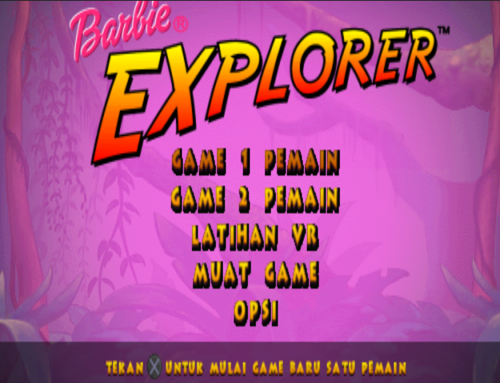
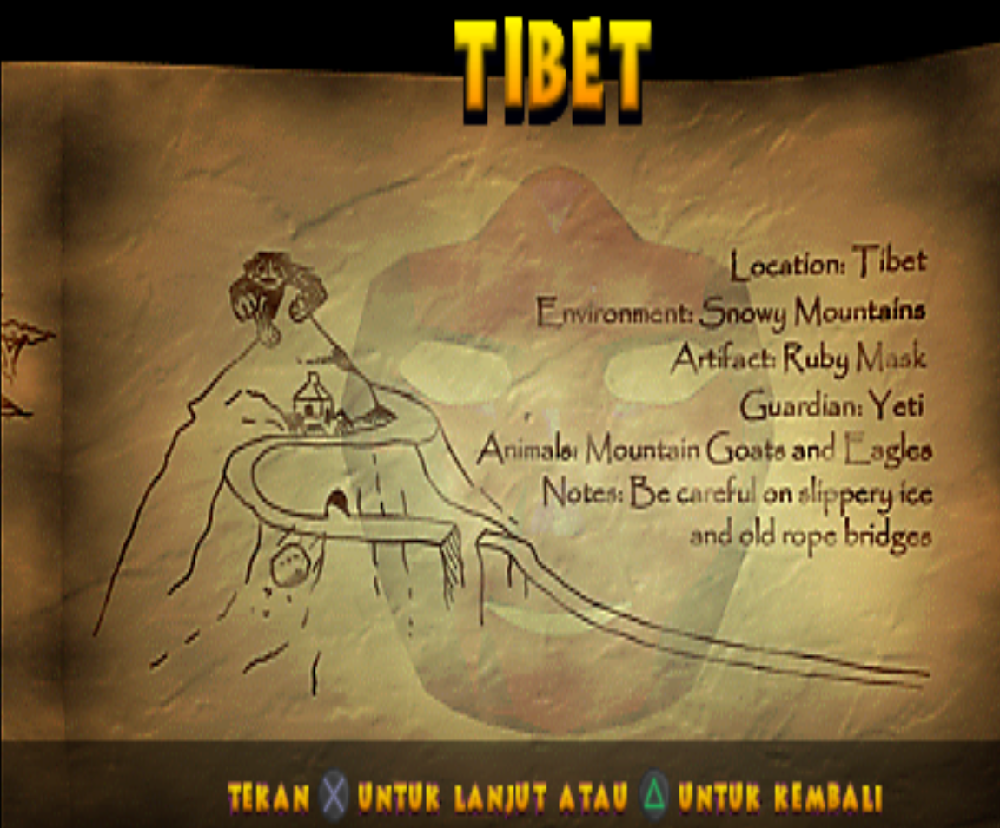
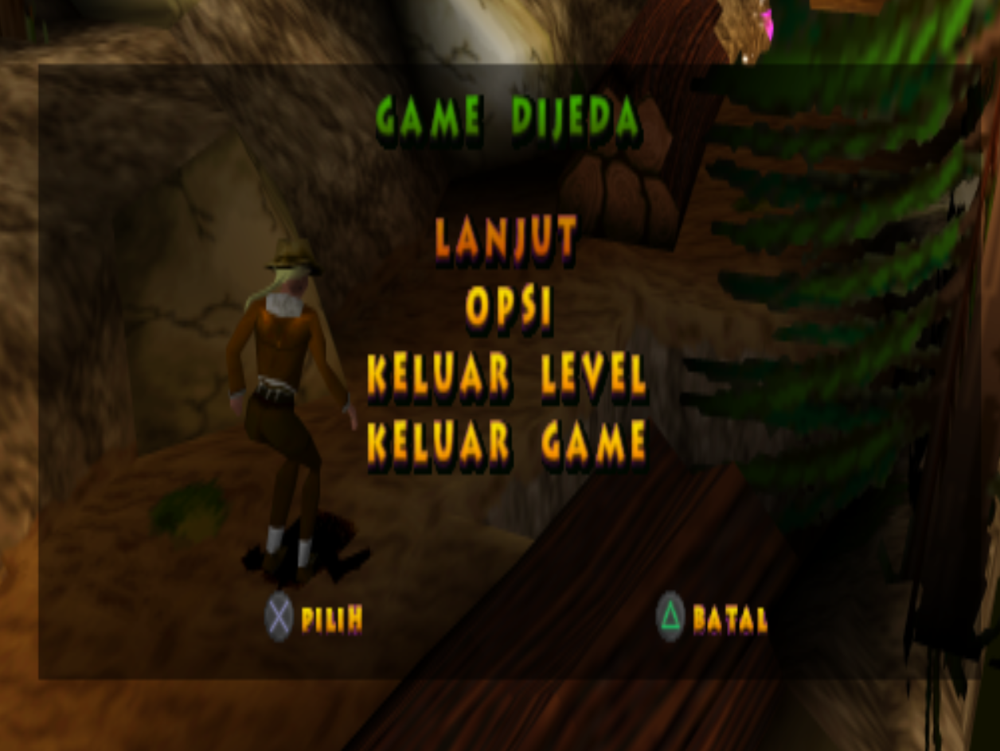

# Barbie Explorer (PS1) - Indonesian Translation

Unofficial Indonesian fan translation for *Barbie Explorer* (PlayStation, NTSC-U, `SLUS-01361`).

The patch rewrites the in-game text inside `BX_NTSC.EXE`. File size and disc layout are unchanged, so no filesystem rebuild is needed. Only 11 sectors of the data track are modified.



## Contents

- [Screenshots](#screenshots)
- [Status](#status)
- [Requirements](#requirements)
- [Compatibility](#compatibility)
- [Usage](#usage)
- [Translation file](#translation-file)
- [Disc and file format](#disc-and-file-format)
- [Translation constraints](#translation-constraints)
- [Contributing](#contributing)
- [Known issues](#known-issues)
- [Credits](#credits)
- [Legal](#legal)

## Screenshots

<table>
  <tr>
    <td></td>
    <td></td>
  </tr>
</table>

## Status

| Component | Status |
|---|---|
| Menus, options, pause and game-over screens | Translated |
| Button prompts (`tekan{untuk ...`) | Translated |
| MEMORY CARD, save/load and controller messages | Translated |
| Level and location names, power-up names | Translated |
| Credits (job titles only) | Translated |
| Names of people, `BARBIE EXPLORER`, `HAVAS INTERACTIVE`, `RUNECRAFT`, debug strings | Left in English |
| Voice acting (`SPEECH*.XAI`) | Not translated (audio) |
| FMV (`INTRO.STR`, `END.STR` and others) | Not translated |
| Text stored as graphics (logos, briefing images, title) | Not translated |

227 of 357 text strings found in the executable are translated. The remaining 130 are names, debug strings and a few words intentionally kept as-is.

## Requirements

- A legitimate copy of the game, dumped to `.bin/.cue`
- A PPF3 patcher (PPF-O-Matic, ApplyPPF, or similar)
- An emulator (DuckStation or similar) or modded hardware

## Compatibility

The patch targets the data track (Track 1) of the US release. Other regions or revisions are untested.

Original `Track 1` image (raw 2352-byte sectors, 234,894,240 bytes, 99,870 sectors):

```
MD5     : af52b7db9974804db1b4dba4ffb7fa9b
SHA-1   : 5389ce49fe938431154a0009202ba9c1aa06c51d
SHA-256 : 4ac68044cbe2f566844c07bfbec1ab4ee24bec9e4a8a1a3afb359e1bc6ec1584
```

Patched output (same size):

```
MD5     : 49aead99f27811cc47e1e5e17595dee7
SHA-1   : 46e271355a83c0a0f3825cbee91de94633522536
SHA-256 : b4b67cb0c6a55224cdfd0e5a95db55cf29a545edcac8698d29e9675aae7121c5
```

`Barbie_Explorer_ID.ppf`:

```
MD5     : 407576a78411d0cfed0cec5594728874
SHA-1   : fc711658ef631427ad0e6ef96f17e4ffa8a911bf
SHA-256 : 553851e0739dd0ca2935dee5e84472cd75687dd0db998956e3ab1e0070d3a9e5
```

## Usage

1. Dump your disc to `.bin/.cue`. Keep the audio tracks as they are.
2. Verify the hash of the data track (`Track 1`) against the table above.
3. Make a copy of the original `Track 1` `.bin`.
4. Apply `Barbie_Explorer_ID.ppf` to the copy with your PPF3 patcher.
5. Keep the original `.cue` file. The patched `.bin` has the same size, so the cue sheet does not need changes.
6. Load the `.cue` in your emulator.

Always patch a copy. IPS is not used because this image is larger than the 16 MB offset limit of the IPS format. An xdelta patch can be made from the original and patched images if needed.

## Translation file

`translation/Barbie_Explorer_naskah_EN-ID.txt` lists every translated string:

```
[0x01628]
EN: NO MEMORY CARD FOUND / IN MEMORY CARD SLOT 1.
ID: MEMORY CARD TIDAK DITEMUKAN / DI MEMORY CARD SLOT 1.
```

| Field | Description |
|---|---|
| `[0x....]` | Byte offset of the original string inside `BX_NTSC.EXE` |
| `EN` | Original text (line breaks shown as ` / `) |
| `ID` | Translation (line breaks shown as ` / `) |

## Disc and file format

**Image.** Raw `MODE2/2352` data track. Files are stored in Form 1 sectors. After editing, the EDC and ECC of each modified sector are recomputed.

**File.** `BX_NTSC.EXE` (PS-X EXE, LBA 60097, 593,920 bytes). Modified sectors: `60099-60104`, `60326-60328`, `60346-60347`.

**Addresses.** The executable loads at `0x80010000` with a 0x800-byte header:

```
address = 0x8000F800 + file_offset
```

**Strings.** ASCII, null-terminated, aligned to 4 bytes, with manual line breaks (`\n`). Text is referenced by 32-bit pointers in two data tables (near `0x72858` and `0x7330C`), so strings can be moved.

**Text blocks.** Three contiguous blocks are re-laid out by the patcher: menu and message text (`0x1628-0x2BCC`), credits (`0x3060-0x38FC`), and small labels (`0x7CF38-0x7D06C`). All strings in a block are repacked and their pointers updated. Nothing outside these blocks is touched.

## Translation constraints

- The repacked text of a block must fit the block size.
- Keep `\n` and the button glyphs `{`, `}` in the same count and position. The D-pad glyph bytes `0xBA`, `0xCD`, `0xCE` must be kept as they are.
- Use only characters already present in the original strings.
- Keep line width close to the original (about 39 characters for upper-case messages, 44 for mixed-case, 54 for button prompts).
- Names of people are kept in English.

## Contributing

1. Find the string by offset in `translation/Barbie_Explorer_naskah_EN-ID.txt`.
2. Propose a new `ID` line that fits (see [Translation constraints](#translation-constraints)).
3. Open a pull request, or an issue that lists the offset and proposed text.

For rendering bugs (text out of the box, wrong characters), include a screenshot, the emulator and version, and the string offset.

## Known issues

- Not tested end to end. Text box and label widths were estimated from the original English text, so some lines may overflow.
- Some labels and credit titles are abbreviated to fit the block size (for example `WAPRES`, `MGR`).
- The word `OF` (as in "x of y") is left in English because there was no room to translate it.
- Voice acting, FMV and graphics are still in English, so spoken story and on-screen text will not match.
- Only one game revision has been tested.

## Credits

- The Handsome Guy: [Nopal]
- Original game: Havas Interactive, developed by Runecraft

## Legal

This is a non-commercial fan project and is not affiliated with Mattel, Havas Interactive, Runecraft, or any rights holder of Barbie. This repository does not contain any game data, ISO or ROM. You must supply your own legally obtained copy. Do not redistribute patched game images.
